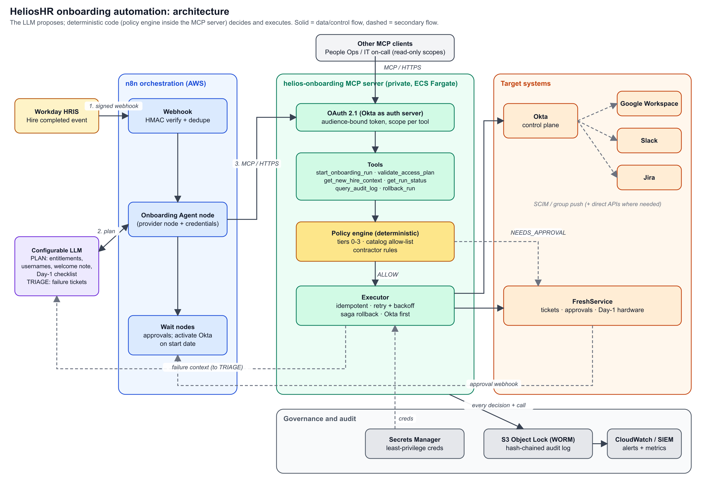

# 1. Architecture



Sources: `../diagrams/architecture.svg` (editable vector) and `../diagrams/architecture.png`. Left to right: Workday → n8n → MCP server (auth → tools → policy engine → executor) → target systems, with the configurable LLM beside n8n and governance/audit underneath.

## ASCII fallback

```
 Workday ──signed webhook──▶ n8n (verify HMAC, dedupe) ──▶ Onboarding Agent node ◀──▶ LLM (plan / triage)
                                                                  │ MCP (HTTPS, OAuth2.1, scoped)
                                                                  ▼
   People Ops / IT on-call ──MCP (read-only)──▶ ┌───────── helios-onboarding MCP server ─────────┐
   (AI client)                                    │ tools ─▶ POLICY ENGINE ─▶ EXECUTOR (retry/saga) │
                                                 └──────┬──────────┬─────────────┬────────────────┘
                                                  ALLOW │  NEEDS_APPROVAL      │ every step
                                                        ▼          ▼             ▼
                              Okta ─SCIM─▶ Google / Slack / Jira   FreshService   S3 Object Lock audit ─▶ SIEM
                              (+ direct API for what SCIM can't)   (tickets,
                                                                    approvals)
```

## Data flow, step by step

| # | From → To | What moves | Control |
|---|-----------|-----------|---------|
| 1 | Workday → n8n | `worker.hire.completed` event | HMAC signature, `event_id` dedupe |
| 2 | n8n → configured LLM | Minimised hire record + access catalog (tier 3 hidden) + HR notes in an `untrusted` block | PII allow-list, prompt-injection framing |
| 3 | configured LLM → MCP | Tool calls (`start_onboarding_run` …) | OAuth 2.1 scope per tool, schema validation |
| 4 | MCP policy engine | Proposed entitlements → ALLOW / NEEDS_APPROVAL / DENY | Catalog allow-list, tiers, contractor rules |
| 5 | MCP executor → Okta/Google/Slack/Jira | Idempotent writes, Okta first | Per-system least-privilege secret, retry, saga |
| 6 | MCP → FreshService | Approval tickets, Day-1 hardware ticket, failure tickets (LLM-written) | – |
| 7 | Everything → S3 | One hash-chained audit record per decision/call | Object Lock, hash chain |
| 8 | n8n Wait → MCP → Okta | At start date 06:00 UTC, call `activate_onboarding_run`; MCP checks the event, run state and date before activation | Provision scope, date-gated, idempotent, audited |

## What the MCP server exposes (and deliberately does not)

- **Tools:** `get_new_hire_context`, `validate_access_plan`, `get_run_status`, `query_audit_log` (read scopes); `start_onboarding_run` (provision scope, `dry_run=true` default); `activate_onboarding_run` (provision scope, start-date check); `record_access_approval` (approval scope, distinct manager and app-owner identities required); `retry_approved_grant` (provision scope); `rollback_run` (admin scope).
- **Resources:** `onboarding://policy/catalog` (versioned catalog, tier 3 omitted).
- **Prompts:** `triage_onboarding_failure`.
- **Not exposed:** raw Okta/Slack/Jira passthrough, direct tier-2 grants, tier-3 grants, credentials. Approval decisions have a separate scoped tool that enforces two distinct authorized human roles before the grant runs.
